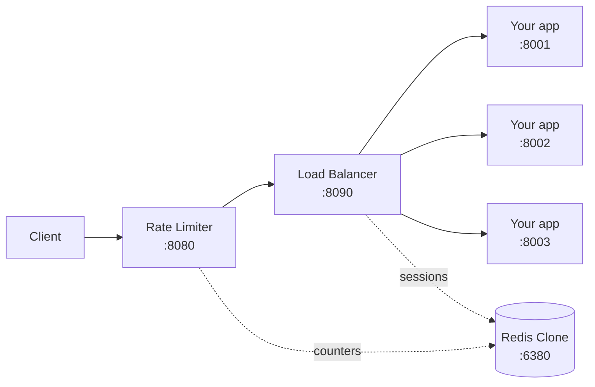
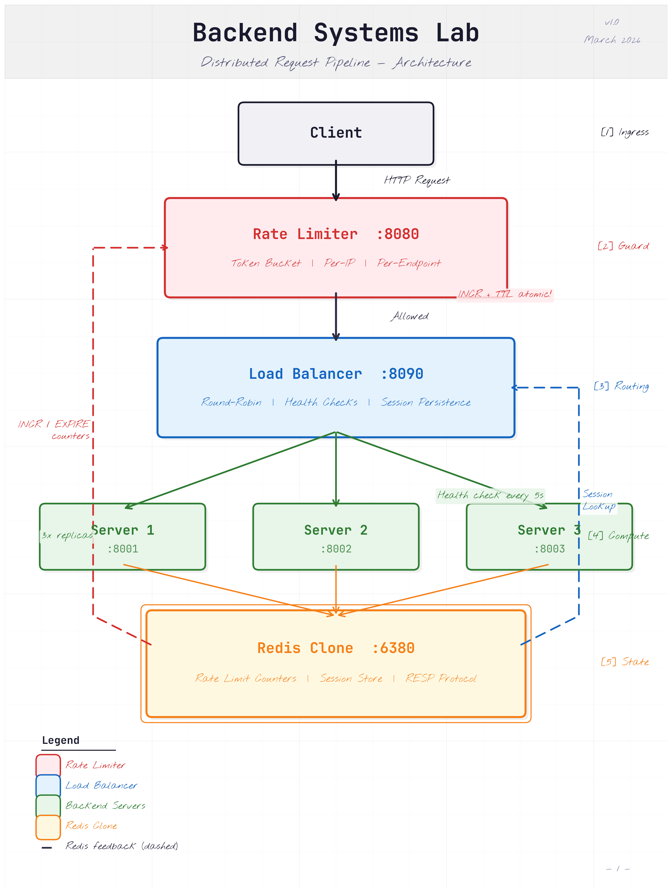

# Integration Guide

How to use the Redis clone, rate limiter, and load balancer inside your own application — in any
language — and exactly where the edges are.

---

## Overview

Backend Systems Lab is three independent services that form one HTTP request pipeline. They are
**infrastructure you run alongside your app**, not a library you import. A request enters at the
rate limiter and flows through to your backend:



The Redis clone is the shared state behind the limiter (rate-limit counters) and the load balancer
(session map).



There are two ways to plug your application in, and they are independent — use either or both:

=== "Pattern A — Use the Redis clone"

    Point any standard Redis client at `127.0.0.1:6380` and use it as a cache, counter, or simple
    session store. Works from any language. [Jump to Pattern A](#pattern-a-use-the-redis-clone-in-your-app)

=== "Pattern B — Run behind the pipeline"

    Replace the demo backends with your real HTTP app. You get rate limiting, load balancing,
    health checks, and sticky sessions for free. [Jump to Pattern B](#pattern-b-put-your-app-behind-the-pipeline)

---

## Who this is for

This is a from-scratch teaching/portfolio system. It is a strong fit for:

- Local development and prototyping that needs a cache + rate limiting + load balancing without standing up real Redis/NGINX.
- Learning how these primitives actually work — the code is small and readable.
- Internal tools and demos where the data is disposable.

It is **not** a drop-in replacement for production Redis or a production load balancer. See
[Production readiness](#production-readiness) before trusting it with real data or traffic.

---

## Quick start

### Option 1 — Docker Compose (everything at once)

Brings up the Redis clone, three demo backends, the load balancer, and the rate limiter:

```bash
docker compose up --build
```

Then send a request through the front door (the rate limiter):

```bash
curl -i http://127.0.0.1:8080/api/data
```

### Option 2 — Run locally with Python

```bash
python3 -m venv .venv && source .venv/bin/activate
pip install -r requirements.txt

# start each service (backgrounded here; use separate terminals if you prefer)
python -m redis_clone.src.server &
python shared/mock_server.py 8001 &
python shared/mock_server.py 8002 &
python shared/mock_server.py 8003 &
python -m load_balancer.src.server &
python -m rate_limiter.src.server &
```

!!! tip "Verify"
    A healthy pipeline returns `200` with `X-RateLimit-Remaining` and `X-Served-By` headers.
    Run the suite with `pytest` (88 tests).

---

## Pattern A · Use the Redis clone in your app

The clone is a real TCP server speaking the Redis wire protocol (RESP2 and RESP3). Any standard
Redis client connects to it unchanged — Python, Node, Go, Ruby, the `redis-cli`, anything — as long
as you stay inside the supported command set.

### Python (`redis-py`)

```python
import redis.asyncio as redis

r = redis.from_url("redis://127.0.0.1:6380")   # RESP3 default — works

await r.set("user:42:name", "Mark", ex=3600)   # value with a 1-hour TTL
name = await r.get("user:42:name")              # b"Mark"
views = await r.incr("page:/home:views")        # atomic counter
await r.expire("page:/home:views", 60, nx=True) # TTL only if none set
ttl = await r.ttl("user:42:name")               # seconds remaining
```

### Node (`ioredis`)

```javascript
import Redis from "ioredis";
const r = new Redis(6380, "127.0.0.1");

await r.set("session:abc", "server-1", "EX", 3600);
const server = await r.get("session:abc");
await r.incr("hits");
```

### From the shell

```bash
redis-cli -p 6380 SET greeting "hello" EX 30
redis-cli -p 6380 GET greeting
redis-cli -p 6380 INCR counter
```

### Supported commands

This is the **entire** command set. Anything not listed returns `-ERR unknown command`.

| Command | Notes |
|---------|-------|
| `PING` | Liveness; optional echo message. |
| `ECHO` | Returns the given string. |
| `SET` | With optional `EX` (seconds) or `PX` (milliseconds) TTL. |
| `GET` | Returns the value or null if missing/expired. |
| `INCR` | Atomic +1. Preserves existing TTL. |
| `INCRBY` | Atomic +N. Preserves existing TTL. |
| `DEL` | Delete one or more keys; returns count deleted. |
| `EXISTS` | Count of keys that exist and are live. |
| `EXPIRE` | Set TTL; `NX` sets it only if none exists. |
| `TTL` | Seconds left; `-1` no expiry, `-2` missing. |
| `DBSIZE` | Number of live keys. |
| `FLUSHALL` / `FLUSHDB` | Clear everything. |
| `MULTI` / `EXEC` / `DISCARD` | Queued transactions (used by the rate limiter pipeline). |
| `AUTH` | Password auth, active only when `REQUIREPASS` is set. |
| `HELLO` | Protocol negotiation (RESP2/RESP3 handshake). |
| `COMMAND` / `CLIENT` / `CONFIG` | Minimal stubs so clients connect cleanly. |

!!! warning "What is NOT here"
    No hashes (`HSET`), lists (`LPUSH`), sets, sorted sets, pub/sub, or `SCAN`/`KEYS`. Plain caching
    (`GET`/`SET`/`EX`), counters (`INCR`), and simple key→value sessions work. A framework session
    backend or job queue that relies on hashes or `SCAN` will fail on its first unsupported command.

!!! warning "Strings only"
    Values are stored and returned as UTF-8 strings. It is **not binary-safe** — don't store raw
    bytes, images, or pickled blobs. Store text or base64.

---

## Pattern B · Put your app behind the pipeline

The rate limiter and load balancer are reverse proxies. Your app runs as the backend instances they
forward to. The demo uses `shared/mock_server.py`; you replace it with your real HTTP app. Your app
can be in **any language or framework** — the proxies only speak HTTP.

### The one requirement: a health endpoint

Each backend must answer `GET /health` with HTTP `200`. The load balancer probes it every
`HEALTH_CHECK_INTERVAL` seconds (default 5) with a 2-second timeout. Three consecutive failures take
a backend out of rotation; it returns on the next successful probe.

### With Docker Compose

In `docker-compose.yml`, swap each backend's `command` for your app and keep the port. The load
balancer finds backends by the `SERVER_n_HOST` / `SERVER_n_PORT` variables already wired there:

```yaml
  backend1:
    build: .
    command: ./run-my-app --port 8001   # <- your app instead of mock_server.py
    ports: ["8001:8001"]
```

### Running locally

Start N instances of your app on ports `8001`, `8002`, `8003`, then point the load balancer at them
with environment variables:

```bash
export SERVER_1_HOST=127.0.0.1 SERVER_1_PORT=8001
export SERVER_2_HOST=127.0.0.1 SERVER_2_PORT=8002
export SERVER_3_HOST=127.0.0.1 SERVER_3_PORT=8003
python -m load_balancer.src.server
```

!!! tip "How requests reach you"
    Clients hit `:8080`. The rate limiter adds an `X-Forwarded-For` header with the caller's IP and
    forwards to the load balancer, which picks a healthy backend and adds `X-Served-By`. Your app
    sees a normal HTTP request and just responds.

---

## Reference · Rate limiter

Entry point on port **8080**. Uses a sliding-window counter (two-bucket approximation) stored in the
Redis clone, so limits hold across multiple rate-limiter instances sharing one Redis.

### Per-endpoint limits

| Endpoint | Limit | Window |
|----------|-------|--------|
| `/api/search` | 10 | 60s |
| `/api/data` | 100 | 60s |
| `/api/upload` | 5 | 60s |
| `/health` | 1000 | 60s |
| any other path (default) | 60 | 60s |

Limits live in `rate_limiter/src/config.py`. Edit `ENDPOINT_LIMITS` or `DEFAULT_CONFIG` and restart
the rate limiter to change them.

!!! warning "Clients are keyed by real peer IP"
    The limiter keys on the TCP peer address (`request.remote`) and **deliberately ignores any
    inbound `X-Forwarded-For`**, because that header is spoofable. If you put this behind another
    proxy, every client will share one IP bucket. Terminate at the rate limiter, or adapt the keying
    logic.

### Response headers & status codes

| Header / status | Meaning |
|-----------------|---------|
| `X-RateLimit-Limit` | Max requests in the window for this endpoint. |
| `X-RateLimit-Remaining` | Estimated requests left in the window. |
| `X-RateLimit-Reset` | Unix timestamp when the window resets. |
| `Retry-After` | Seconds to wait — sent only on `429`. |
| `429 Too Many Requests` | Over the limit; request never reaches your app. |
| `502 Bad Gateway` | Load balancer unreachable. |
| `504 Gateway Timeout` | Upstream took longer than `FORWARD_TIMEOUT`. |

---

## Reference · Load balancer

Listens on port **8090**. Reverse-proxies to the backend pool with health-aware routing and
Redis-backed sticky sessions.

### Routing algorithm

The active algorithm is **round-robin**. `LeastConnections` and `WeightedRoundRobin` are implemented
in `load_balancer/src/algorithms.py` but not wired to a config switch — to use them, change the
`router = RoundRobin()` line in `load_balancer/src/server.py`.

### Sticky sessions

The first response sets a `session_id` cookie (1-hour max-age) and pins that session to the chosen
backend in Redis. Subsequent requests carrying the cookie return to the same backend. If the pinned
backend is unhealthy, the session is cleared and the client is re-routed automatically. Every
response carries `X-Served-By` with the backend that handled it.

### Health & failover

- Probe: `GET /health` every `HEALTH_CHECK_INTERVAL`s (default 5), 2s timeout.
- **3 consecutive failures** → backend marked `UNHEALTHY` and removed from rotation.
- Recovers on the **next successful** probe.
- On a connection failure mid-request, the balancer retries the next backend automatically (safe — the backend never received the request).
- `503` when no backend is healthy; `504` when a backend times out.

---

## Reference · Configuration

All settings are environment variables. Defaults match local development, so you usually need none.

| Variable | Default | Purpose |
|----------|---------|---------|
| `REDIS_HOST` | 127.0.0.1 | Where clients reach the clone. |
| `REDIS_PORT` | 6380 | Clone TCP port. |
| `REQUIREPASS` | _(empty)_ | Set to require `AUTH`. |
| `MAX_KEYS` | 0 | 0 = unlimited; >0 enables LRU eviction. |
| `RATE_LIMITER_PORT` | 8080 | Public entry port. |
| `LOAD_BALANCER_HOST` | 127.0.0.1 | Where the limiter forwards. |
| `LOAD_BALANCER_PORT` | 8090 | Load balancer port. |
| `SERVER_1_PORT`…`SERVER_3_PORT` | 8001–8003 | Backend ports. |
| `SERVER_1_HOST`…`SERVER_3_HOST` | 127.0.0.1 | Backend hosts. |
| `HEALTH_CHECK_INTERVAL` | 5 | Seconds between health probes. |
| `FORWARD_TIMEOUT` | 30 | Seconds before a proxied request times out. |
| `CONNECT_TIMEOUT` | 5 | Seconds before a TCP connect to a backend times out. |

!!! warning "Local processes don't auto-load .env"
    The services read variables straight from the environment. When running locally, you must
    `export` them (or use a tool like `dotenv`). Docker Compose passes them in for you. Editing
    `.env` alone has no effect on a bare `python -m …` run.

---

## Limitations

| Area | Limitation |
|------|------------|
| Redis persistence | **None.** In-memory only. A restart loses every key. |
| Redis data types | Strings/counters only. No hashes, lists, sets, pub/sub, or `SCAN`. |
| Binary values | UTF-8 strings only — not binary-safe. |
| Redis scaling | Single node. No replication, clustering, or failover. |
| Auth | Off by default. Optional single-password `AUTH` via `REQUIREPASS`. |
| Transport security | No TLS anywhere. Plaintext on localhost/Docker network. |
| Rate-limit accuracy | Sliding-window _approximation_; counts can be off by ~1 at window edges. |
| Client identity | Keyed on peer IP; ignores inbound `X-Forwarded-For`. Don't double-proxy. |
| LB algorithm | Round-robin only without a code change. The round-robin cursor is per-process, not shared across LB instances (sessions _are_ shared via Redis). |

---

## Production readiness

!!! danger "Read before relying on it"
    This system is a learning/portfolio build. Use it for local dev, demos, internal tools, and
    study. Do **not** use it to store data you can't afford to lose, or to front real user traffic.

If you want the same shape in production, map each service to its battle-tested equivalent:

| This lab | Production equivalent |
|----------|-----------------------|
| Redis clone | Real Redis / Valkey (persistence, replication, full command set, TLS, ACLs). |
| Rate limiter | NGINX `limit_req`, Envoy, or an API gateway (Kong, Tyk). |
| Load balancer | NGINX, HAProxy, Envoy, or a cloud LB (ALB, GCLB). |

The value of this lab is understanding the moving parts so you configure the real thing with intent
— not as a substitute for it.

---

## Troubleshooting / FAQ

**My Redis client connects but every command hangs or errors.**
Make sure you're on a current client. The clone supports both RESP2 and RESP3; modern `redis-py`
(≥5) negotiates RESP3 by default and that works. If you pinned an exotic protocol or hit an
unsupported command, you'll see `-ERR unknown command` — check the
[supported command list](#supported-commands).

**I get `-ERR unknown command`.**
The command isn't implemented. The clone is a deliberate subset — see
[Pattern A](#pattern-a-use-the-redis-clone-in-your-app). Switch to a supported command or use real Redis.

**Everything returns `429`.**
You exceeded the per-endpoint limit for your IP within the 60s window. Wait for `Retry-After`
seconds, raise the limit in `config.py`, or use an endpoint with a higher limit. Note all local
requests share the `127.0.0.1` bucket.

**I get `503 Service Unavailable`.**
No backend is healthy. Confirm your backends are running and that `GET /health` returns `200` on
each. Watch the load balancer logs for health-check failures.

**My data vanished after a restart.**
Expected — the Redis clone is in-memory with no persistence. See [Limitations](#limitations).

**All my clients look like one IP.**
The rate limiter keys on the TCP peer address and ignores `X-Forwarded-For`. If something else
proxies traffic before the rate limiter, every client collapses into one bucket. Put the rate
limiter at the edge.
